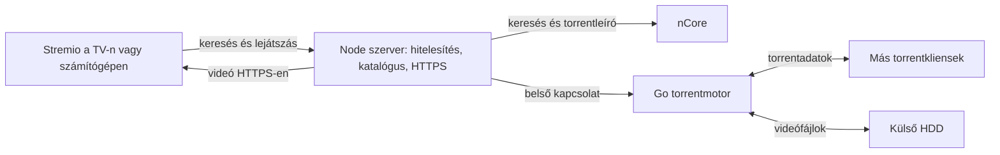

# nCore 0.8.3 – teljes működési leírás

Ez a leírás a `codex/ncore-catalog-playback-limiter` ág 0.8.3-as manifestverziójáról szól. A 2026. október 16-án Linux Minten használt forrást és annak tényleges működését rögzíti. Az alap a `312a1ac` commit; erre került az nCore-azonosítók és a HTTPS-lejátszás javítása. A gyökér `package.json` örökölt 0.8.0-s értéke megmaradt; a Stremio számára a manifestben szereplő **0.8.3** a változat azonosítója.

## 1. Mire használható?

Saját nCore-fiókból elérhető filmeket és sorozatokat keres meg, és Stremióban kínálja fel a forrásokat. A Linuxos szerver végzi a torrentkezelést és tárolja az adatokat; a TV, telefon vagy számítógép a szervertől kapja a videót. A TV-re nem kell torrentklienst telepíteni.

A „Saját videók” külön kiegészítő, külön szolgáltatással. Nem része ennek az nCore-forrásnak vagy verziószámnak.

## 2. Katalógusok és keresés

Öt katalógust hirdet a Stremiónak:

| Katalógus | Tartalom |
| --- | --- |
| nCore – Keresés filmek | Filmek cím szerinti keresése |
| nCore – Keresés sorozatok | Sorozatok cím szerinti keresése |
| nCore – Friss magyar 4K | Magyar HD-kategória, 2160p/UHD/4K névmintával |
| nCore – Friss magyar 1080p | Magyar HD-kategória, 1080p/1080i névmintával |
| nCore – Friss magyar sorozatok | A magyar HD-sorozatkategória friss elemei |

Keresőkifejezés nélkül a listák friss feltöltéseket kérnek, kifejezéssel seederszám szerint rendezett találatokat. Egy katalógusoldal legfeljebb 24 címet tartalmaz; a lapozás támogatott. Egy lekérés legfeljebb 25 nCore-oldalt vizsgál. Azonos IMDb-azonosítóból egy borító jelenik meg; a különböző kiadások a megnyitás után válnak elérhetővé.

A listázáshoz érvényes `tt...` IMDb-azonosító szükséges. A borítót, címet, leírást és epizódadatokat elsősorban a Cinemeta adja. Katalóguslistában Cinemeta-hibánál megmaradhat egy egyszerű cím, de a részletes adatlap lekérése ettől még meghiúsulhat.

Az nCore-katalógus saját `ncore-tt...` azonosítókat használ. A 0.8.3 a hagyományos `tt...` és a saját `ncore-tt...` azonosítókat is hirdeti, így a kliens borítóról továbblépve is lekérheti a megfelelő adatokat és forrásokat.

## 3. Hogyan választ forrást?

Egy film vagy epizód megnyitásakor a szerver először IMDb-azonosító alapján keres nCore-on. Ha így nincs használható találat, a Cinemetából kapott cím alapján is próbálkozik. A cím alapján talált kiadást **bizonytalan forrásként** jelzi, mert másik mű is lehet.

A források sorrendjét pontozás alakítja ki:

- A már teljesen tárolt torrent nagy előnyt kap; a részben tárolt kisebbet.
- Számít a felhasználó nyelve és a kiválasztott felbontások.
- Előnyt kap a több seederrel rendelkező forrás.
- A nagy, kevés seederrel rendelkező 4K-kiadások hátrébb kerülhetnek.
- Sorozatnál a korábban megkezdett évadhoz és kiadócsoporthoz való illeszkedés is számít, ha a betöltött fájladatok alapján felismerhető.

Ez ajánlási sorrend, a felhasználó továbbra is másik forrást választhat. Az első, biztosnak tekintett forrás „Ajánlott” jelölést kap.

A forrásleírás mutathatja az új letöltést, a már meglévő százalékot, a „HDD-ről indul” állapotot, a nyelvet, a felbontást, a fájlméretet, a seederszámot és a ratio értékét. Ezek a szerver által ismert adatokból származó jelzések. A korábbi statisztikák és a betöltött torrentlista miatt nem minden esetben pontos, friss, fájlonként ellenőrzött állapotot jelentenek.

## 4. Hogyan tölt le?

1. A katalógus vagy borító megnyitása metaadatokat és torrentleírókat kérhet le. Ez még nem a teljes videó letöltése.
2. A kiválasztott forrás lejátszásakor a szerver megkeresi a torrentet a futó motorban.
3. Ha nincs betöltve, letölti és elmenti a `.torrent` fájlt, majd hozzáadja a motorhoz.
4. Filmnél vagy epizódnál a megfelelő médiafájlt olvasni kezdi. A torrentmotor a kiszolgáláshoz szükséges darabokat beszerzi a többi klienstől, és a letöltési könyvtárba írja.
5. A TV HTTPS-en kapja az adatot a Node szerveren keresztül. A teljes fájl elkészülte előtt megkezdődhet a lejátszás. Tekerésnél új bájttartományt kérhet a kliens.

**A változat nem általános, folyamatos háttérletöltő.** Nincs benne olyan külön feladat, amely minden megnyitott torrent minden fájlját feltétlenül 100%-ra tölti. Sorozatcsomagnál a kiválasztott epizód lejátszása nem jelenti az egész évad elkészülését. A lejátszási korlátozó emellett kifejezetten letiltja a régi, részleges torrentek üresjárati letöltését.

A már meglévő adatok megmaradnak és újra felhasználhatók, amíg nem törlik őket. A használhatósághoz a szervernek, HDD-nek és a hálózatnak elérhetőnek kell lennie.

## 5. Hogyan tölt vissza? A lejátszási korlátozó

A torrentmotorban a seedelés engedélyezett. Ez azt jelenti, hogy a már meglévő darabokat más torrentklienseknek átadhatja. A tényleges feltöltéshez kell olyan peer is, amely ezeket éppen tőlünk kéri. A feltöltött adatmennyiség nem garantált.

| Állapot | Aktív torrent letöltése | Aktív torrent feltöltése | Többi betöltött torrent |
| --- | --- | --- | --- |
| Nincs aktív lejátszási jelölés | Nincs engedélyezett háttérletöltés | Nincs külön aktív torrent | Letöltés tiltott, feltöltés engedélyezett |
| Van aktív lejátszási jelölés | Engedélyezett, amikor adat kell | Engedélyezett | Letöltés és feltöltés is tiltott |

**Egyszerre egy torrent lehet aktív a teljes szerveren**, nem felhasználónként vagy TV-nként. Ha egy másik készülék másik torrentet indít, az veheti át az aktív állapotot, és az előző lejátszás megszakadhat vagy megakadhat.

Az aktív állapot lejárata minden megjelöléskor **4 órával későbbre** kerül. A lejátszási végpont és a Go-motorhoz érkező tényleges GET fájlkérés is megjelöli az aktív torrentet. Az új tartománykérések ezért újra kitolhatják a határidőt. A motor 10 másodpercenként alkalmazza a szabályt; bizonyos API-kérések is kiváltják az alkalmazását.

**A TV Stop gombjához nincs külön „azonnal vége” jelzés.** Ha a film megáll, a többi torrent visszatöltése csak az utolsó jelöléstől számított 4 órás lejárat után térhet vissza. A 4 óra nem feltétlenül a film indításától számít. A motor újraindításakor ez a memóriában tartott aktív jelölés elveszik.

Nincs külön, felületen állítható feltöltési/letöltési sebességkorlát vagy ratio elérésekor automatikusan megállító szabály ebben az ágban. A routeren beállított porttovábbítást a program nem igazolja; a feltöltésfigyelő nem portnyitottság-teszt. A telepítési példa a 42069 TCP és UDP peer portot teszi elérhetővé a hoston.

## 6. Újraindítás és torrentek visszatöltése a motorba

A `.torrent` fájlok, a letöltött adatok és a mentett statisztikák megmaradnak. A program induláskor korlátozott mennyiséget tölt vissza a motorba:

- Legfeljebb 12 késznek minősített torrentet, elsősorban ratio, feltöltés és frissesség szerint.
- Legfeljebb 4 további torrentet a fennmaradó legfrissebb elemekből. Ezek között kész, részleges vagy ismeretlen állapotú is lehet.
- Összesen legfeljebb 16 torrentet.

Az ezen felüli torrentek fájljai nem törlődnek, de nem mindegyik seedel automatikusan. Egy kimaradt forrás lejátszása ismét betöltheti azt.

Induláskor és lejátszás miatti hozzáadáskor nincs teljes előzetes hash-ellenőrzés (`verify: false`). A késznek minősítés mentett előrehaladásból és fájlméret-vizsgálatból is származhat. A megfelelő fájlméret önmagában nem bizonyítja minden torrentdarab meglétét vagy épségét.

## 7. Torrents kezelőfelület és statisztikák

Adminisztrátorként a **Torrents** oldalon látható:

- a betöltött torrent neve és teljes mérete;
- a meglévő/letöltött adat mennyisége, a feltöltött adat, az előrehaladás és a ratio;
- feltöltési összesítés, kész és részleges torrentek száma;
- tárhelyfigyelő és törlési javaslatok;
- hasonló nevű, azonos felbontású duplikációjelöltek;
- torrentenként kézi törlés.

A torrentlista 10 másodpercenként, a kiegészítő panelek 30 másodpercenként frissülnek, amíg az oldal nyitva van. A háttérben 120 másodpercenként is történik statisztikai lekérés; lemezre akkor ment, ha a követett érték változik. A forráslista lekérése is frissíthet és menthet statisztikát.

**A ratio itt nem nCore-ról olvasott hivatalos ratio:** a Go-motor az adott futás feltöltött adatát a torrent teljes méretével osztja. A program a korábbi és az aktuális feltöltés, ratio, előrehaladás és letöltött mennyiség közül a nagyobb értékeket őrzi. Ez megakadályoz bizonyos visszaeséseket a kijelzésben, de az újraindítások között nem adja helyesen össze az összes feltöltést. A panel ezért nem hiteles, teljes élettartamra szóló elszámolás. A „Feltöltés működik” jelzés korábban mentett feltöltésből is származhat, nem bizonyít aktuális forgalmat.

Az összesítés a motorba jelenleg betöltött torrenteket vizsgálja, nem minden HDD-n meglevő fájlt.

## 8. Törlés és helyfelszabadítás

A kézi törlés a torrentet és a hozzá tartozó letöltött adatokat is eltávolítja, majd a program a `.torrent` fájlt is törli.

A tárhelyfigyelő 200 GiB szabad hely alatt jelez. Legfeljebb 8 kézi törlési jelöltet ajánl: legalább 99,9%-os előrehaladású és legalább 1-es helyi ratio értékű torrenteket. A duplikációjelöltek név- és felbontásmintákból származnak; ez nem a tartalom azonosságának bizonyítása. Ezek a panelek önmagukban nem törölnek automatikusan.

Külön bekapcsolható az időzített, **hit'n'run utáni automatikus törlés**. A beállított cron szerint lekéri az nCore hit'n'run oldalát, az ott `-` állapotúnak felismert elemekből készít törölhető listát, és a motorban megtalált torrenteket törli. Ez nem fix számú seedóra vagy ratio alapján helyben számolt szabály; az oldal HTML-feldolgozásától és az nCore válaszától függ. A kézi törlési ajánlás helyi ratio-feltétele önmagában nem igazolja az nCore-kötelezettség teljesítését.

## 9. Felhasználók és eszközök

Van adminisztrátor és normál felhasználó, felhasználónként magyar/angol nyelvi és felbontási preferenciákkal. Eszközönként létrehozható és visszavonható token. A Stremio személyes kiegészítőcíme ezt a tokent tartalmazza; így a TV-nek nem kell megadni az nCore-jelszót. A személyes kiegészítőcímet nem szabad nyilvános dokumentációba másolni.

A Linux bejelentkezési jelszava, a kezelőfelület jelszava, az nCore-belépés és az eszköztoken külön dolgok. A kiszolgáló indítására adott jelszómentes sudo-jogosultság nem törli ezeket a jelszavakat.

## 10. HDD, SSD, hálózat és a laptop használata

A jelenlegi Linuxos telepítésben a nagy videóadatok a külső HDD-re kerülnek a `/addon/downloads` bind mounton keresztül. A konfiguráció, SQLite-adatbázis, torrentleírók, gyorsítótárak és statisztikák az SSD-n maradtak. A Docker és a rendszer naplói is írhatnak az SSD-re; ez nem teljesen írásmentes SSD-s működés.

Az SSD-n megtartott régi letöltési könyvtár biztonsági másolat, nem aktív letöltési cél. A másolás önmagában nem szabadította fel a helyét.

Az UUID-alapú csatolás és a Docker systemd-függősége megakadályozza, hogy lemez nélküli induláskor a letöltési csatolási könyvtár az SSD-n kezdjen megtelni. A `create_host_path: false` önmagában nem helyettesíti a lemezazonosító ellenőrzését: egy régi könyvtár lemez nélkül is létezhet.

Normál gépindításkor a Docker és a `restart: unless-stopped` szabály indíthatja a konténert. Kézi leállítás és HDD-leválasztás után a lemez visszadugása nem garantálja a szerver újraindulását; ilyenkor indítani kell a szolgáltatást és a konténert.

A laptop lehajtott fedél melletti működése a Linux energia- és fedélbeállításaitól függ; ezt nem az addon intézi. A TV-nek el kell érnie a szerver helyi IP-címét. A 2,4 és 5 GHz-es sáv önmagában nem akadály, de külön vendéghálózat, kliensizoláció vagy routerbeállítás megakadályozhatja az átjárást. A mostani beállítás helyi hálózati használat; külső internetes eléréshez további hálózati beállítás kell.

## 11. Mi javult a 0.8.3-ban?

| Korábbi hiba | Javítás |
| --- | --- |
| Az nCore-katalógus borítója megjelent, de a kliens nem kérte le rendesen a saját azonosítójú adatlapot/forrást | A manifest a `ncore-tt` prefixet is hirdeti a `tt` mellett |
| A lejátszás egy kliens számára elérhetetlen HTTP 8080-as címre irányított | A Node szerver a belső Go-kiszolgáló videóját a meglévő HTTPS-végponton proxyzza |
| A működő változat és a HDD-s telepítés csak a Linuxon volt meg | A tényleges két forrásjavítás és külön HDD-s telepítési minta is bekerült ebbe az ágba |

A katalógusok, torrentkezelés, gyorsítótár, seedelés és lejátszási korlátozó az előző ág funkciói; nem a 0.8.3-ban újonnan megírt funkciók.

## 12. Ismert korlátok és ellenőrzési eredmények

- **A tárhelypanel ebben a forrásban az `ADDON_DIR` fájlrendszerét méri.** Ha csak a `downloads` alkönyvtár van külön HDD-re csatolva, a panel az SSD szabad helyét írhatja „HDD” felirattal. A tényleges letöltési cél ettől még a HDD. A helyet ilyenkor `df -h` paranccsal kell ellenőrizni a HDD csatolási pontján.
- Az első, helyi hálózati beállító varázsló örökölt hibája üres helyi címet menthet. A működő telepítésben ezt korábban javítottuk az adatbázisban. Új telepítésnél a Settings oldalon ellenőrizni és elmenteni kell a tényleges helyi IPv4-címet; a kódhibát ez a kiadás nem módosítja.
- A 4 órás lejátszási jelölés, az egy aktív torrent és az indulási 16-os korlát befolyásolja a seedelést és a több eszközön történő nézést.
- Nincs videóátkódolás: a TV-nek támogatnia kell a kiválasztott fájl kép- és hangformátumát.
- Az nCore oldalfelépítésének változása, a Cinemeta vagy a helyi HTTPS-név/tanúsítvány szolgáltatásának hibája működési zavart okozhat.
- A mentett forráslista nCore-lekérési hiba esetén segíthet, de lehet elavult. Üres, hibamentes találati listánál nincs automatikus visszaesés a mentett listára.

A telepítéskor a teljes Docker-build lefutott. A HDD-re költözéskor 7 fájl, 22 931 561 996 bájt tartalmi összehasonlítása egyezett, a konténerből indított próbafájl ténylegesen a HDD-re került. A későbbi visszacsatlakoztatás után a keresés 9 Toy Story-találatot, a forráslista 11 forrást adott. Egy korábban lejátszott videó első 65 536 bájtja HTTPS 206 válasszal, helyes bájttartománnyal megérkezett. Ez adatátviteli ellenőrzés, nem teljes filmhosszú lejátszási vagy minden TV-n elvégzett teszt. A felhasználó korábban a hálózat rendezése után működő TV-s elérést jelzett. Az automatikus HDD-csatolás függősége ellenőrzött, de a költözés óta külön hidegindítási teszt nem történt.

## 13. A megállapítások forrása

| Téma | Kód |
| --- | --- |
| Katalógusok | [`catalog-definitions.ts`](../server/src/services/catalog/catalog-definitions.ts), [`catalog.service.ts`](../server/src/services/catalog/catalog.service.ts) |
| nCore-keresés, cache, hit'n'run | [`ncore.service.ts`](../server/src/services/torrent-source/ncore/ncore.service.ts) |
| Forrássorrend és jelzések | [`stream.service.ts`](../server/src/services/stream/stream.service.ts) |
| HTTPS-lejátszás | [`stream.controller.ts`](../server/src/controllers/stream.controller.ts) |
| Lejátszási korlátozó, fájlkiszolgálás | [`main.go`](../torrent-server/main.go) |
| Újraindítás, statisztikamentés, tárhely | [`torrent-store.service.ts`](../server/src/services/torrent-store/torrent-store.service.ts) |
| Ratio számítása | [`responses.go`](../torrent-server/internal/responses/responses.go) |
| Kezelőfelület | [`torrents.page.tsx`](../client/src/pages/torrents/torrents.page.tsx) |
| HDD-s telepítés | [`Linux Mint útmutató`](../deployment/linux-mint/README.hu.md) |
